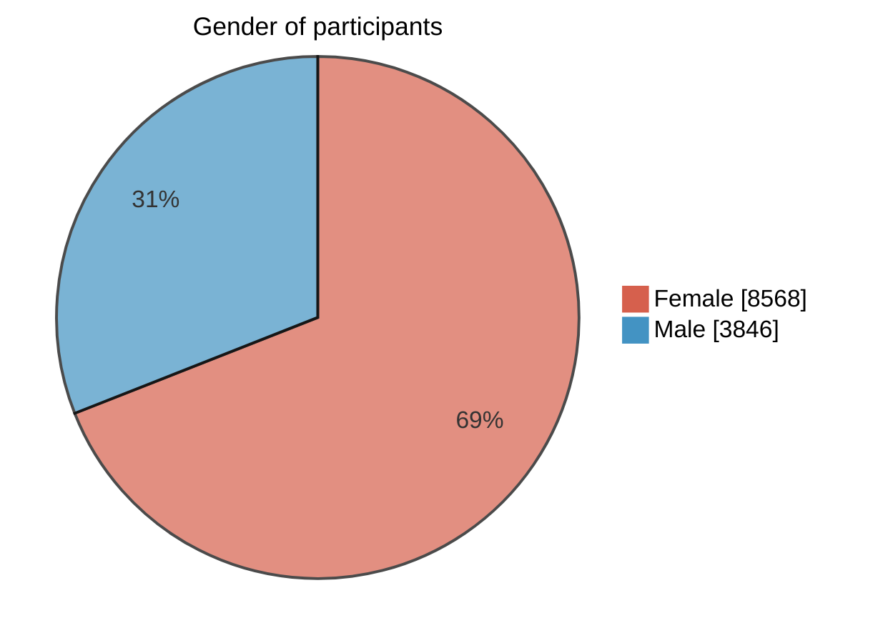
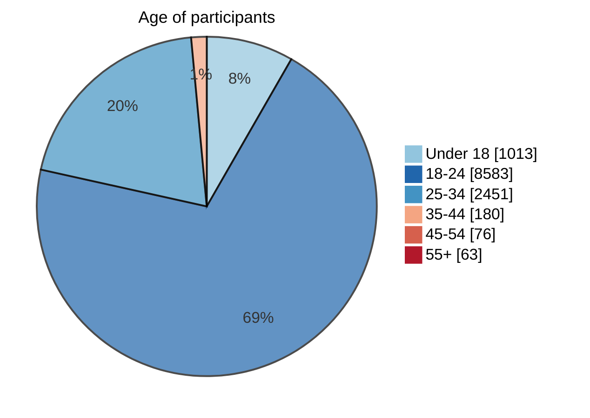

# Ethical Decision-Making for Autonomous Vehicles

A data-driven decision model for unavoidable-collision dilemmas, learned from a survey with nearly **12,500 participants**. Each participant faced 25 trolley-style scenarios: a car with failed brakes must hit one of two groups. The project turns the answers into a scoring function that compares the two groups.

Authors: Mert Gürlek, Zeynep Görü, Rüveyda Tüfekçioğlu

## Survey

**How the form works**

- At the start we ask people to imagine they are driving a car with failed brakes. The car can't stop, so it will definitely hit someone. If they steer away it goes onto another road, where someone else will definitely get hurt too. Whatever they choose decides which side is harmed.
- We added a note saying it's a voluntary thought experiment, there are no right or wrong answers, and we don't collect any personal data. It's based on the trolley problem (Foot, 1967).
- The option a person picks is the group that **gets hit**, so the other group is spared. We keep this in mind when labeling the data later.

**How we designed the questions**

We changed only one thing per question (species, health, age, fame, closeness, moral character, wealth, gender, nationality, body weight, pregnancy, pedestrian vs. cyclist, group size). That way each answer tells us about one preference and nothing else is mixed in. Closeness is "your own mother vs. a stranger". For some factors we asked twice, once with equal group sizes and once with the numbers against the group people would normally spare, to see when numbers start to win (for example mother vs. 1 stranger and mother vs. 5 strangers).

**Who answered**

%69 of the participants are female and %31 are male. The median age is 21 and about %70 are between 18 and 24, so the sample is mostly young.

<table>
<tr>
<td width="50%">



</td>
<td width="50%">



</td>
</tr>
</table>

## Algorithms and methods

### 1. Preprocessing

- The Google Forms export is wide, with one row per respondent and one column per question.
- Each answer text is parsed with keyword rules into the group size (numeric) and 12 categorical attributes: `varlık` (species), `sağlık` (health), `yaş` (age group), `ünlü` (fame), `bağlılık` (closeness), `iyilik` (moral character), `zenginlik` (wealth), `cinsiyet` (gender), `uyruk` (nationality), `kilo` (body weight), `hamile` (pregnancy), `araç` (pedestrian or cyclist).
- An attribute the question does not mention is set to `belirtilmemiş` (not specified), so nothing is assumed about the group.
- The data is reshaped to the long format: for every respondent and question there are two rows, one per group. The spared group gets 1 and the hit group gets 0. This gives us **620,700 rows**.

### 2. Model (`ethical_decision_model.py`)

**Encoding**

The 12 categorical columns are one-hot encoded with pandas `get_dummies`. The group size stays numeric. The result is 35 features.


**Algorithm**

Logistic regression (scikit-learn, `lbfgs` solver, L2 regularization with C = 1.0, `max_iter = 1000`) predicts the probability that a group is spared.


**Why logistic regression?**

The coefficients can be read directly: a positive weight means a group with that attribute is more likely to be spared, and a negative weight means it is more likely to be hit. A black-box model would not show which factors drive the decisions.

### 3. Decision rule

The score of a group is

```
score = w_size × group size + Σ w_attribute   (over the group's attributes)
```

and the vehicle spares the group with the higher score. `puan()` implements this and warns if an attribute value was never seen in the survey.

### 4. Evaluation

- **Split.** 80/20 by respondent (`random_state = 42`), so nobody appears in both the training and test sets. A row-level split would leak, because the two rows of a question come from the same person.
- **Metrics.** Single-group accuracy (does the model predict spared or hit for one group) and pairwise accuracy (does the spared group get the higher score of the two). The pairwise one matches how the score is used.

## Results

| Metric (held-out respondents) | Value |
|---|---|
| Accuracy, single group (spared or hit) | %75.6 |
| Accuracy, which of the two groups is spared | **%79.2** |

The model is trained on 620,700 rows and converges in 46 iterations.

### Learned weights

| Attribute value | Weight | Attribute value | Weight |
|---|---|---|---|
| closeness: own mother | +3.80 | closeness: stranger | -5.13 |
| moral character: good | +3.65 | moral character: bad | -4.35 |
| gender: woman | +1.92 | age: adult | -1.82 |
| age: baby | +1.31 | gender: man | -1.52 |
| group size (per person) | +1.01 | nationality: foreign | -1.43 |
| nationality: Turkish | +0.98 | health: disabled | -1.28 |
| health: healthy | +0.68 | wealth: rich | -1.12 |
| wealth: poor | +0.66 | fame: celebrity | -0.99 |
| fame: not famous | +0.51 | species: dog | -0.81 |
| body weight: thin | +0.32 | pregnant | -0.73 |
| species: human | +0.22 | cyclist | -0.55 |
| not pregnant | +0.14 | body weight: overweight | -0.54 |

Weights for `belirtilmemiş` (not specified) are left out of the table. They are in the full output of `ethical_decision_model.py`.

### Findings

- **Closeness and moral character dominate.** %98 spare their own mother over a stranger, and %99 spare a good person over a bad one. Even against 5 strangers, %91 spare their mother. Even when three bad people face one good person, %94 spare the good one.
- **Numbers matter a lot, but not always.** %96 choose 3 people over 1, and %93 choose 3 unknown people over 1 celebrity. People are split on 1 healthy person vs. 3 disabled people (%41.5 spare the healthy one).
- **Vulnerable groups are protected.** %77 spare a baby over an adult, and %88 spare 2 babies over 1 adult. %98 spare a pregnant woman over an adult.
- **Humans over animals, but with limits.** %73 spare a person over 2 cats, while %90 spare 3 cats over 1 dog, so group size outweighs species in the animal pairs.
- **Group preferences.** %93 spare a woman over a man. %83.5 spare 1 Turkish person over 1 foreign national, but only %52 do so when the foreign group has 2 people. %78 spare a thin man over an overweight one. %69 spare a poor person over a rich one, and %87 spare 3 poor people over 1 rich person.
- **Pedestrians over cyclists:** %68 spare the pedestrian.

### How to read the weights

- The weights are relative to the other values of the same attribute, and are fitted jointly. A single weight is not an independent effect. For example, "pregnant" has a negative weight even though %98 spare a pregnant woman over an adult. That group is also a woman (+1.92), and the comparison group is an adult (-1.82). Always compare **total scores** of two groups.
- Examples from the scoring function: a mother beats 5 strangers (3.41 vs. -1.49) and a baby beats an adult (1.73 vs. -1.40), as most respondents chose.


## Limitations and ethics

- The model describes the **preferences of the survey sample**, which is young (median age 21) and mostly female. It does not say what a vehicle *should* do.
- Several attributes, such as wealth, nationality, fame, gender and weight, would be discriminatory and illegal to use in a real vehicle. In this project they serve to analyze which factors drive public opinion. They are not a proposal for deployment.
- Each question changes one factor, so weights for attributes that never occur together are not tested. Scoring a made-up group that mixes many attributes extrapolates beyond the survey.
- The age field is self-reported and contains some invalid entries. The model does not use it.

Stack: Python, pandas, scikit-learn, matplotlib.
